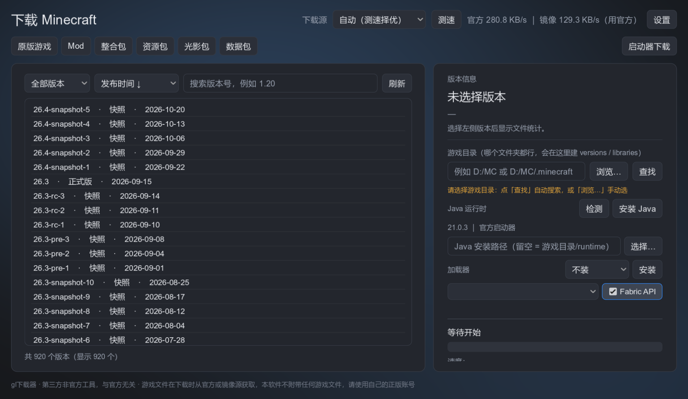
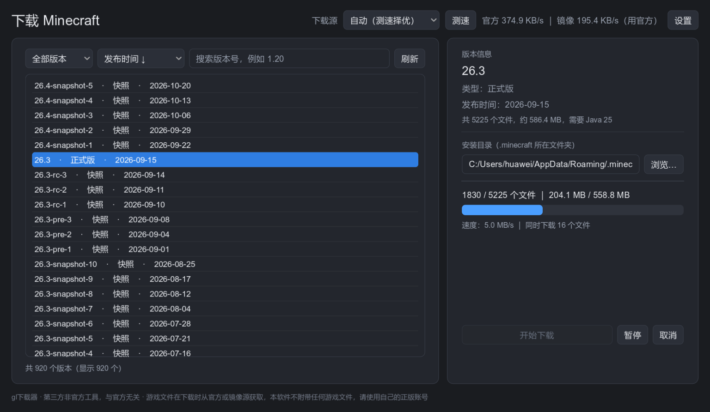
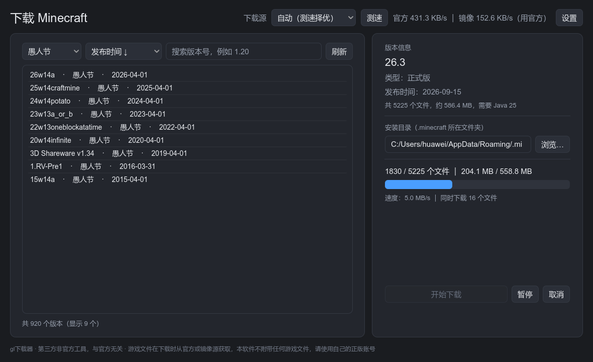
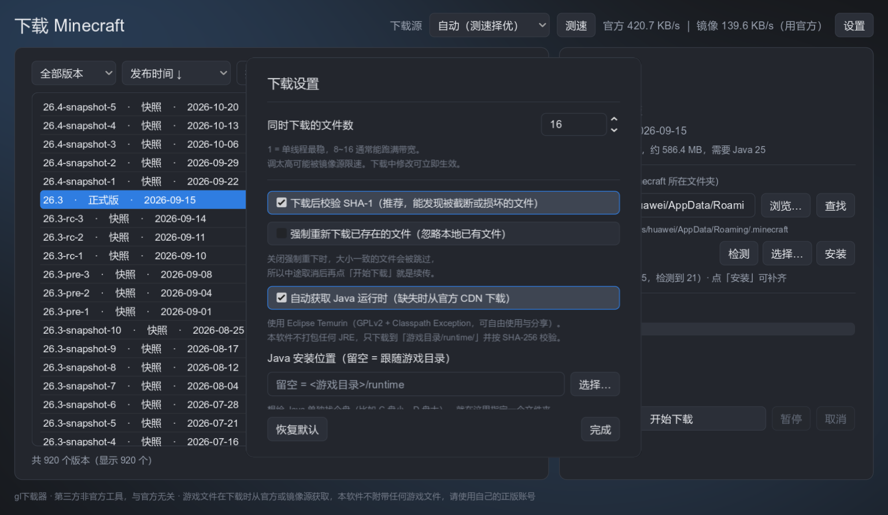
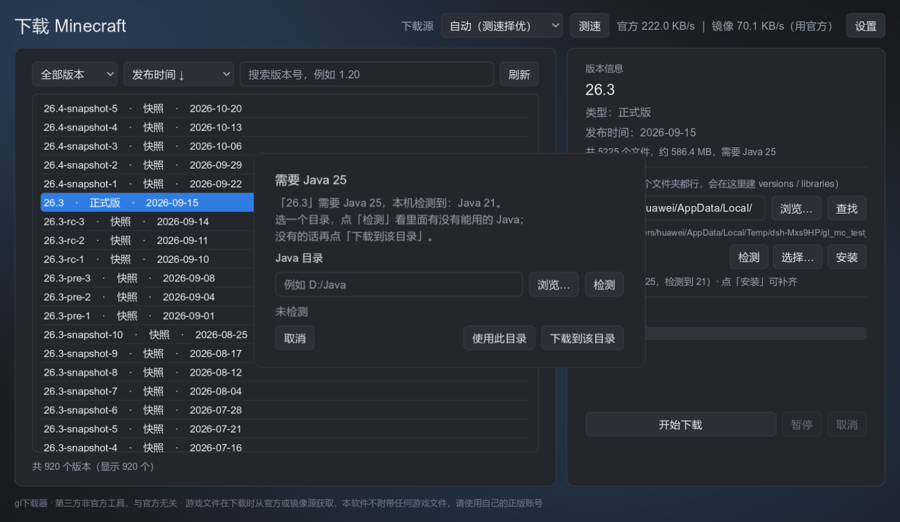
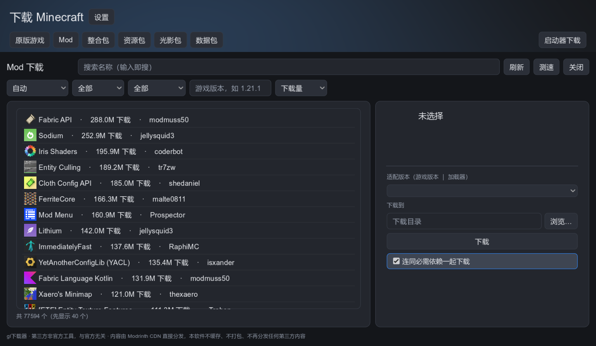

# gl下载器 —— Minecraft 原版下载模块

仿成熟启动器下载模块的桌面端实现：**选版本 → 选源（可自动测速）→ 选目录 → 并发下载 → 校验 → 解压**。


> **免责声明**：本软件是个人开发的**第三方非官方工具**，与游戏官方没有任何关联，也未获得其授权或认可。"Minecraft" 与 "我的世界" 是其各自权利人的商标，此处仅用于说明本软件的用途。
>
> 本软件**不附带、不分发任何游戏文件**（不含客户端 jar、资源文件、版本 JSON 等）。所有游戏内容都在下载时从官方服务器或公开镜像实时获取，请使用你自己拥有的正版账号游玩。请勿将下载得到的 `versions/`、`libraries/`、`assets/` 目录打包再分发。









## 功能

| 能力 | 说明 |
| --- | --- |
| 版本选择 | 从官方版本清单拉全部版本（实测 920 个） |
| 版本筛选 | 全部 / 正式版 / 快照 / **愚人节** / 远古版本（快照不含愚人节，互不重叠） |
| 版本排序 | 发布时间 ↓（默认）、发布时间 ↑、版本号 A→Z、版本号 Z→A |
| 搜索 / 刷新 | 版本号即时搜索；「刷新」按钮重新获取清单 |
| 加载状态 | 获取清单期间，列表、计数、状态栏统一显示「加载中…」；成功后不再弹提示 |
| 双下载源 | 官方源与 BMCLAPI 镜像；计划阶段只生成官方 URL，发请求前按源改写。**一个源挂了会自动换另一个**（拉列表、生成计划都有兜底） |
| 自动测速 | 两个源**后台并发**探测（不阻塞版本列表加载），按实测速率择优，结果显示在右上角 |
| 自定义镜像 | 设置里可填自己的反代 / 校内镜像地址（需遵循 BMCLAPI 路径布局） |
| 下载目录 | 手填或「浏览…」选文件夹，默认 `%APPDATA%\.minecraft`；设置写入 `user://mc_downloader_settings.cfg` |
| 完整安装清单 | 版本 JSON、客户端 jar、依赖库、原生库、资源索引、全部资源对象、日志配置 |
| 并发下载 | 默认 16 路（可在设置里 1~64 调节，下载中改也立即生效），写 `.part` 临时文件，完成后原子改名 |
| 完整性校验 | 可开关的 SHA-1 校验；已存在文件按大小跳过 → 中断后再点「开始下载」就是续传 |
| 强制重下 | 一键忽略本地已有文件全部重下（排查坏文件用） |
| 稳定性 | 单文件失败重试 3 次；45 秒无字节增长判停滞并重试；失败不中断整批，明细写入 `user://mc_downloader_errors.log` |
| 控制 | 暂停（不再开新任务，在传的传完）、取消（立即中断）、实时进度/速度 |
| 窗口缩放 | 等比放大 + 铺满：更宽就加宽版面，更高就多显示版本，**无黑边**；启动时窗口自动撑到屏幕 80%（不超过 1600×1000），最小 900×560 |
| Java 运行时 | 切版本就自动检测（伴随「检测中…」+ 转圈）；版本不够会弹窗问要不要装；可手动「选择…」已有 Java，或「安装」到游戏目录 |
| 动态效果 | 背景流光、页面淡入、旋转加载圈、版本标题回弹、列表切换淡入、进度条平滑、完成泛光、按钮回弹 |
| 老版本兼容 | 1.7.10 这类老版本自动识别 `natives-windows(-64/-32)` 分类器，下载后解压到 `versions/<id>/natives` |
| 内置文件 | 版本 JSON 与资源索引直接复用已抓到的内容写盘，不额外请求 |

### 愚人节版本是怎么认出来的

官方清单里没有专门的字段，它们和普通快照一样标成 `snapshot`。所以用两条规则：

1. 内置一份 id 名单（`McVersion.APRIL_FOOLS_IDS`），已收录 2015–2025 的 8 个；
2. 兜底：**快照 + 发布日期是 4 月 1 日 + id 不含 pre/rc** 也算愚人节。

第 2 条在实测中抓到了 2026 年的 `26w14a`，所以以后新出的愚人节版本即使没加名单也能认出来。列表里它们显示成「愚人节」。

## 下载设置

右上角「设置」里可以调（右下角有「恢复默认」）：

| 项目 | 默认 | 说明 |
| --- | --- | --- |
| 同时下载的文件数 | 16 | 1 = 单线程最稳；8~16 通常能跑满带宽；太高可能被镜像限速。下载中修改立即生效 |
| 下载后校验 SHA-1 | 开 | 能发现被截断/损坏的文件，代价是每下载完一个文件多一次哈希 |
| 强制重新下载已存在文件 | 关 | 关闭时大小一致就跳过（= 续传）；打开则全部重下 |
| 自定义镜像根地址 | 空 | 留空用 `https://bmclapi2.bangbang93.com`；自定义地址需支持 `/mc`、`/v1`、`/assets`、`/maven` 四个前缀 |
| 界面缩放 | 自适应（跟随窗口） | 自适应 = 按窗口等比放大；80% / 90% / 110% / 125% 是在这个基础上再缩小/放大，放大时会按版面最小尺寸自动收敛，避免被裁切 |
| 自动获取 Java 运行时 | 开 | ~~缺失时自动下载~~ 改为：**版本不足时弹窗询问**（不会自动下载）。关掉就连提示也没有 |

### 窗口缩放是怎么算的

```
实际缩放 = min(窗口宽 / 1180, 窗口高 / 720) × 界面缩放倍率
```

- **窗口按比例变大** → 整个界面（含文字）等比放大，字不会变小；
- **只有一边变大** → 缩放倍率不变，多出来的空间变成版面：更宽就加宽左右面板，更高就多显示版本行；
- 因此既**不会出现黑边**，也**不会被拉伸变形或裁掉**；
- 设置面板底部有实时读数：`窗口 1536×892 ｜ 逻辑尺寸 1239×720 ｜ 实际缩放 1.24×`，拖窗口时会跟着变，可用来确认缩放确实生效。

本机实测（1920×1080 屏幕）：

| 窗口尺寸 | 逻辑尺寸 | 实际缩放 | 表现 |
| --- | --- | --- | --- |
| 1536×892（启动默认） | 1239×720 | 1.24× | 整体放大，铺满 |
| 1900×760（很宽很矮） | 1800×720 | 1.06× | 左右版面明显加宽 |
| 1180×950（只变高） | 1180×950 | 1.00× | 多显示约 3 行版本 |
| 1600×900 | 1280×720 | 1.25× | 整体放大 |
| 1600×900 + 界面缩放 110% | 1164×655 | 1.37× | 字更大，无裁切 |

## 加载不出来怎么办

以前是「测速选中哪个源就只认哪个源」，那一个源抽风就永远"加载失败"。现在改成了：

1. **双源自动兜底**：首选源失败会立刻换另一个源再试，成功就把当前自动源切换过去并记住；两个都失败才报错，并且会把两个源各自的失败原因一起显示。
2. **测速不再卡加载**：测速放到后台跑，版本列表立刻开始拉（实测 3.9 秒出 920 个版本，之前要先等测速）。
3. 状态栏会写清原因，对照着看就行：

| 状态栏提示 | 含义 / 处理 |
| --- | --- |
| 无法连接到服务器 | 网络不通或被墙；开代理的话注意 **Godot 不走系统代理**，需要 TUN/全局模式 |
| 域名解析失败 | DNS 有问题，换 DNS 或换源 |
| 请求超时 | 线路太慢，点「刷新」或「测速」换源 |
| 服务器拒绝访问（HTTP 403） / 请求太频繁被限流（HTTP 429） | 被源限流了，等几分钟再试 |
| 服务器出错（HTTP 5xx） | 源自己挂了，换源或稍后再试 |

还可以：点「刷新」重试；点「测速」看哪个源通；在设置里填一个自己能通的「自定义镜像根地址」。

## 游戏目录放哪都行（不要求叫 .minecraft）

**软件不替用户挑目录**：首次启动输入框是空的，状态提示「请选择游戏目录：点「查找」自动搜索，或「浏览…」手动选」，没选之前「开始下载」是禁用的。

跟 PCL 一样，`D:\MC` 这种**随便命名的空文件夹**就能当游戏目录——软件自己在里面建 `versions/`、`libraries/`、`assets/`、`runtime/`。

- 手输或点「浏览…」选任意文件夹；
- 点「查找」扫**各盘根目录**（C/D/E/F/G/H）找已经存在的 MC 目录：不一定叫 `.minecraft`，只要里面有 `versions` / `assets` / `libraries` / `runtime` / `launcher_profiles.json` 就算；也会读官方启动器 `launcher_profiles.json` 里自定义过的 `gameDirectory`。找到一个直接填，多个弹列表让你挑；
- 输入完自动校验：
  - 路径不合法（`C:`、盘符根、太短）→ 弹「目录不合法」提示；
  - 指向的是文件 → 弹「不是文件夹」提示；
  - 目录不存在 → 弹「要现在创建吗？」（创建 / 取消）；
  - 合法 → 输入框下面显示「已存在：…」或「不存在，开始下载时会自动创建：…」；
- 旧版本自动存进配置的默认路径已作废（换了配置键 `game_dir_user`），不会再把 `%APPDATA%\.minecraft` 塞给你。

### Java 装哪也随你

- **点「开始下载」不会顺带下载 Java**，只下载游戏文件；
- 需要 Java 时才弹窗，弹窗里让你**自己选目录**、点「检测」看看里面有没有能用的 Java：



  三个出口：`取消` / `使用此目录`（目录里已有合适 Java，直接指定）/ `下载到该目录`（没有才下载）；
- 设置里的「Java 安装位置」可以长期固定一个目录（留空 = 跟随游戏目录），装成 `<你选的>/runtime/temurin-<版本>`；
- 扫描 Java 时也会把这个自定义位置一起扫。

## 会不会覆盖已有文件？

只写「本次安装清单里列的路径」，**不删除任何东西**（除了自己的 `.part` 临时文件和被替换的那一个目标文件）。

| 情况 | 行为 |
| --- | --- |
| 目标文件已存在、大小一致 | 直接跳过，不重写 |
| 目标文件已存在、大小不对 | 只重下**这一个**文件并替换（等于修复坏文件） |
| 版本 JSON / 资源索引已存在 | **跳过，不覆盖**（避免冲掉别的启动器写的版本信息） |
| 勾了「强制重新下载已存在文件」 | 清单内全部重下并覆盖 |
| 清单外的内容：别的版本目录、其它依赖库、`saves`、`mods`、`options.txt`、`launcher_profiles.json`、`resourcepacks`… | **完全不碰** |
| `assets/objects` 资源文件 | 按 hash 命名（`objects/ab/abcdef…`），同 hash 就是同内容，天然不冲突 |
| 老版本原生库解压 | 写进 `versions/<id>/natives`，同名文件被覆盖；同一版本重复解压结果一样 |

所以把游戏目录指向已有的 `.minecraft`（官方启动器或 PCL 装的）时：已装好的版本只会补缺失的文件，不会把别的东西清掉。

## 模组加载器（右侧面板）

右侧面板有「加载器」一栏，给**当前选中的版本**装加载器：

| 项 | 说明 |
| --- | --- |
| 加载器下拉 | 不装 / Fabric / Quilt / Forge |
| 版本下拉 | 选中后自动拉对应版本列表（Fabric、Quilt 走官方 meta，拉不到自动换 BMCLAPI 的 fabric-meta 镜像；Forge 读 promotions） |
| 安装 | 装到当前选中的版本上，装完自动把依赖库加进下载队列 |

**Fabric / Quilt**：官方 meta 给一份带 `inheritsFrom` 的版本 JSON，写到 `versions/<id>/<id>.json`，依赖库走普通下载。
**Forge**：下载官方安装器 jar，用当前 Java 执行 `--installClient <游戏目录>`，装完读 `versions/<mc>-forge-<ver>`；会先补一个最小 `launcher_profiles.json`（安装器要求）。
**OptiFine**：未做（官方只有 GUI 安装器、没有命令行参数，要复刻补丁逻辑）。手动装完不影响这里的使用。

### inheritsFrom 合并

加载器版本本质是「原版 + 补丁」，生成安装清单时会先解析 `inheritsFrom`：

- 递归找父版本 JSON（优先本地 `versions/<父>/<父>.json`，否则按清单地址下载）；
- 合并规则：`libraries` 父在前子在后、同名（`group:artifact`）以子为准；`arguments.game/jvm` 两边拼接；`mainClass`、`assets`、`javaVersion`、`logging` 等子有就用子的；
- 客户端 jar 属于父版本，不会重复下载到子版本目录。

实测（1.7.10 + 模拟加载器）：父计划 30 个库，合并后 31 个，`mainClass` 被子版本覆盖，classpath 末尾是 `versions/1.7.10/1.7.10.jar`。
## Mod / 整合包 / 资源包 / 光影包 / 数据包

顶部常驻导航：**原版游戏 ｜ Mod ｜ 整合包 ｜ 资源包 ｜ 光影包 ｜ 数据包**。导航不会被页面盖住，随时能切回去。



| 筛选 | 说明 |
| --- | --- |
| 来源 | 自动（Modrinth）/ Modrinth / CurseForge（需官方 API Key，当前版本提示未接入） |
| 加载器 | 全部 / Fabric / Forge / NeoForge / Quilt（资源包、光影、数据包不显示） |
| 类型 | Mod 21 项；整合包 15 项；资源包 17 项（写实/卡通/中世纪/现代/简约/主题/字体/界面/音效/模组支持/微调/方块/生物/物品/环境/核心光影）；光影 10 项；数据包 11 项。用的是 Modrinth 的 categories facet，不是本地过滤 |
| 版本 | **手输**游戏版本（如 `1.21.1`），填了只显示支持它的，留空不限 |
| 排序 | 下载量 / 相关度 / 最近更新 / 最新发布 |

- 搜索框**输入即搜**（停止输入 0.35 秒后自动查），回车立刻查。**改加载器/类型/版本/排序不会自动刷新**，点「刷新」才生效
- 搜索模式在「设置」里：只搜名称（本地过滤标题）/ 名称+简介（接口默认）/ 翻译后搜索（中文先翻英文，走 MyMemory 免费接口，失败回退原词）
- 列表带 **项目图标**（并发拉取 + 内存缓存，实测 40/40 全部显示）、下载量、作者
- 点项目 → 右侧显示图标、名称、作者、简介，并拉出**适配版本**（`版本号 ｜ 游戏版本 ｜ 加载器`）
- 下载目录默认：Mod `mods/`、资源包 `resourcepacks/`、光影 `shaderpacks/`、数据包 `saves/datapacks/`、整合包 `modpacks/`，可自己改

### 合规

Modrinth 公开 API，允许第三方客户端调用；带 `User-Agent: gl-downloader/0.3`，低频调用。文件由 Modrinth CDN 直接分发，不缓存、不打包、不再分发。

### 整合包自动安装

点「安装整合包」会自动做完这些：

1. 下载 `.mrpack`
2. 解压 `overrides/` 和 `client-overrides/` 到 `<下载目录>/<包名>/`
3. 读 `modrinth.index.json`，按每个文件的 `downloads[0]` 下到对应相对路径（`mods/`、`config/`…）
4. 读 `dependencies` 拿到 MC 版本与加载器版本，**自动装 Fabric / Quilt 加载器**
5. Forge / NeoForge 的整合包会提示去「原版游戏」页按版本号安装（那两个加载器要跑 Java 安装器，需要选中的 Java）

实测（Fabulously Optimized v6.5.0）：`mc=1.21.1`、`fabric-loader=0.19.3`、50 个文件、包名解析正确。
用合成的 1 文件 mrpack 做了端到端验证：解压 overrides ✅、下载 jar ✅、mods 目录 ✅、加载器信息 ✅。

### Mod 依赖解析

Mod 详情下方有「**连同必需依赖一起下载**」（默认开）。下载主体后会用 Modrinth 的 `dependencies` 递归解析 `dependency_type == "required"` 的依赖，按同样的游戏版本 + 加载器挑最新版本一起下到 `mods/`。

实测：`iris 1.8.14-beta.1+1.21.1-fabric` 声明 1 个必需依赖（`AANobbMI`）→ 解析出 **Sodium 0.8.13** 并加入下载。

### CurseForge

不是不做，是**它必须用 API Key**：CurseForge 的接口全部要求 `x-api-key`，Key 由官方免费发放、绑定到具体应用，随软件分发别人的 Key 属于违反条款。

所以做成了「你自己填」：来源选 CurseForge 后，筛选栏会出现一个 Key 输入框，填进你自己的 Key 就能搜、能看文件、能下载（`curseforge.gd`，搜索/文件列表/下载链接都已实现，包括 403/429 的错误提示）。

没 Key 时选 CurseForge 会提示去填，不会静默失败。
## Java 运行时（全在右侧面板）

右侧「Java 运行时」一栏：

| 元素 | 作用 |
| --- | --- |
| 状态行 | `正在检测 Java…` / `21.0.1 ｜ 游戏目录` / `需要 Java 25（检测到 21）· 点「安装 Java」` / `已取消自动检测 Java` |
| 检测 | 重新扫全机 |
| Java 安装路径 | 可手输，或点「选择…」挑文件夹；**留空 = 游戏目录/runtime** |
| 安装 Java | 装到上面那个路径，过程中状态行 + 进度条都会显示 `正在安装 Java 25… 42%` |

**流程**：切版本 → 自动检测（显示「正在检测 Java…」）→ 版本不够 → 弹一个**纯文字提示**（没有按钮，6 秒自动消失）→ 你去右侧选路径、点「安装 Java」。

设置里可以关掉「切换版本时自动检测 Java」，关掉后状态行会写 `已取消自动检测 Java`。

> 之前容易误会的地方：「选择…」以前既像「用已有 Java」又像「选安装位置」，现在只保留一个 —— **选安装位置**；本机已有的 Java 靠自动扫描就能找到，不用手动指定。

### 在哪找 Java（不要求装在游戏目录）

只要这台机器上有能跑的 Java 就算数。扫描顺序：

1. 自定义 Java 安装位置 / `<游戏目录>/runtime/**`
2. `%APPDATA%\.minecraft\runtime\**`（官方启动器装的）
3. `JAVA_HOME`
4. `PATH` 里的 `java`
5. 常见安装位置（`Program Files` 各发行版、IDE 自带 JBR、`.jdks`、`scoop`、Linux/macOS 路径），逐层往下找
6. **全盘扫描**：C–K 盘根目录下名字像 `java`/`jdk`/`tools`/`dev`/`minecraft` 的目录，最多再下 3 层（`D:\tools\java\jdk-21` 也能找到），有 600 次目录预算，实测约 50ms

版本号：读 `release` → 猜目录名 → 真跑一次 `java -version`。挑选规则：主版本完全一致优先，其次最接近的更高版本。

### 自动下载

1. 查 Adoptium 官方 API 拿包信息（版本、大小、SHA-256）；
2. 下载优先走国内镜像（清华 TUNA），失败回退官方 GitHub；
3. 校验 SHA-256 → 解压到 `<你选的路径>/runtime/temurin-<主版本>/`；
4. 实测：Java 21 的 JRE 46MB，镜像约 22 秒，校验通过，解压后 `bin/java.exe` 正常。

### 授权与合规

Eclipse Temurin 按 GPLv2 + Classpath Exception 提供，官方 FAQ 明确 *"free to use, modify, and share"*。即便如此，本工程**不打包任何 JRE**，只在使用时现取并校验。商标（Java/OpenJDK/Temurin/Adoptium）只做客观引用。
## 动态效果

都是轻量的 Tween，不依赖任何动画资源，代码在 `scripts/ui/ui_fx.gd`：

| 位置 | 效果 |
| --- | --- |
| 背景 | 着色器画的流光：两团淡蓝光晕缓慢漂移，界面不再是一块死板的纯色（`shaders/bg.gdshader`） |
| 启动 | 整个界面 0.4s 淡入 |
| 选中版本 | 版本号标题 0.3s 回弹放大 + 淡入 |
| 检测 Java / 加载列表 | 状态文字显示「检测中…」，旁边是自绘的旋转加载圈；列表加载时「加载中…」点点每秒跳一次 |
| 切换筛选 / 排序 / 搜索 | 版本列表快速淡入（0.16s） |
| 下载进度 | 进度条按帧平滑推进（不会一格一格跳），数字实时更新 |
| 状态栏 | 文案变化时淡入，不会硬切 |
| 下载完成 | 进度条泛一层绿光再回落 |
| 按钮 | 点击时短暂提亮回弹（三个 Java 按钮也都有） |
| 设置面板 | 弹出时内容淡入 |

## 第三方启动器

导航栏右侧「启动器下载」会列出 PCL 官网（meloong.com）、PCL2 GitHub、HMCL 官网与 GitHub、Bakaxl、Prism Launcher 官网与 GitHub 的地址，点开用系统浏览器打开。本软件只提供跳转，不代下、不打包它们的文件。

## 运行

需要 Godot 4.x（工程是用 Godot 4.7.2 验证的）。

1. 用 Godot 打开本工程目录（首次打开时编辑器会重建 `.godot/global_script_class_cache.cfg` 里的 `class_name` 缓存，这是必需的）。
2. 按 F5 运行，主场景是 `scenes/download_page.tscn`。

改软件名只需动两处：`project.godot` 的 `config/name`（窗口标题）、`scripts/ui/download_page.gd` 的 `APP_NAME / DISCLAIMER` 常量（页脚文案）。

## 代码结构

```
scenes/download_page.tscn   界面布局（纯 Control + Container，无自定义绘制）
scripts/ui/download_page.gd 界面与流程（选版本、筛选排序、切源、选目录、设置、驱动下载队列）
scripts/ui/ui_theme.gd      代码生成的主题（深灰蓝配色 + SystemFont 中文回退，不内嵌字体）
scripts/core/download_source.gd  下载源定义、URL 改写规则、并发测速、自定义镜像
scripts/core/http_util.gd        带重试的 await 风格 HTTP 封装 + 中文错误文案
scripts/core/mc_version.gd       版本条目模型（含愚人节识别）
scripts/core/java_runtime.gd     Java 检测 / 按需下载 OpenJDK JRE（含 SHA-256 校验与解压）
scripts/core/install_plan.gd     版本 JSON → 文件清单（含 rules / natives / assets）
scripts/core/download_queue.gd   限并发下载队列（校验、重试、停滞看门狗、统计）
scripts/ui/ui_fx.gd              轻量动画工具（淡入 / 回弹 / 发光）
scripts/ui/spinner.gd            自绘旋转加载圈
shaders/bg.gdshader              背景流光着色器
```

`core` 完全不碰 UI，也不依赖场景树结构，可以单独拿来做 CLI 或复用到「补全资源」页面。

### 下载源改写规则

计划里保存的永远是官方 URL，下载前经过 `DownloadSource.resolve()` 改写：

| 内容 | 改写为 |
| --- | --- |
| 资源文件（assets） | `{镜像}/assets/<前两位>/<hash>` |
| 依赖库（libraries） | `{镜像}/maven/<maven 路径>` |
| 版本 JSON / 清单等元数据 | `{镜像}/<原路径>` |

官方侧的三个元数据域名与两个内容域名写在 `DownloadSource.create()` 里。要加新镜像源（自建反代、校内镜像等），加一个分支即可，UI 只需在 `SOURCE_IDS / SOURCE_LABELS` 各加一项。

## 镜像源合规性

**结论：可以用，但有几条要守。**

1. **授权**：BMCLAPI 作者在项目 README 里明确写了「BMCLAPI 是对外开放的，所有需要 Minecraft 资源的启动器均可调用」，第三方启动器调用不需要单独授权。
2. **路径格式**：镜像遵循 BMCLAPI 的路径布局（`/mc`、`/v1`、`/assets`、`/maven`），本工程按此实现。四类路径都已实测：
   - `/mc` 版本清单 → 920 个版本；
   - `/v1` 版本 JSON + 资源索引 → 正常解析；
   - `/maven` 依赖库 → 下载后 SHA-1 与官方一致；
   - `/assets` 资源文件 → 下载后 SHA-1 与官方一致。
3. **公益服务，别滥用**（本工程的自律措施）：
   - 并发默认 16、上限 64，不做无上限并发；
   - 只下载当前版本实际需要的文件，不预缓存全量资源；
   - 失败重试最多 3 次，45 秒无进展即放弃，不会无限重试刷量；
   - 请求带 `User-Agent: gl-downloader/0.2 (Godot Engine)`；
   - 设置页里署名「镜像加速由 BMCLAPI 提供」。
4. **官方源**：直接访问官方公开的清单与 CDN 端点，与官方启动器的行为一致；离线分发才是问题，运行时下载不是。
5. **保留两个源**是必要的：镜像可能限速或临时下线，官方源也可能很慢，所以默认「自动测速择优」，并且允许填自己的镜像。

## 素材与版权

- 图标 `icon.svg` 由本项目作者自绘，未使用任何官方素材。
- 未内嵌任何字体，界面中文走 `SystemFont`（系统字体），避免字体授权问题。
- 未打包任何游戏文件，也未打包任何 JRE；Java 运行时按需从官方 API 现取（见上方「Java 运行时 → 授权与合规」）。
- 引擎为 Godot（MIT 许可），可商用。
- 本工程代码为原创实现，未复制其他启动器的源码。

## 已知限制 / 可以继续做的

- **不启动游戏**：本工程只做「下载 + 环境准备」，没有启动参数拼装、账号登录、进程守护那部分。Java 路径已经在 `_java_chosen` 里备好，接启动模块时直接取用即可。
- **远古版本的 assets 映射**：`pre-1.6` 的 `virtual` / `map_to_resources` 资源目录没有生成，声音等资源不会出现在老版本里。
- **只做原版**：Forge / NeoForge / Fabric / OptiFine 的安装器链（processor、libraries 合并、`inheritsFrom`）还没接，`InstallPlan` 已是按「可扩展」写的，加一条分支就能支持。
- **单文件不分块**：一个文件走一条 HTTP 连接。想更快可以对大 jar 用 `Range` 分块多线程，在 `DownloadQueue` 里加一种 task 类型即可。
